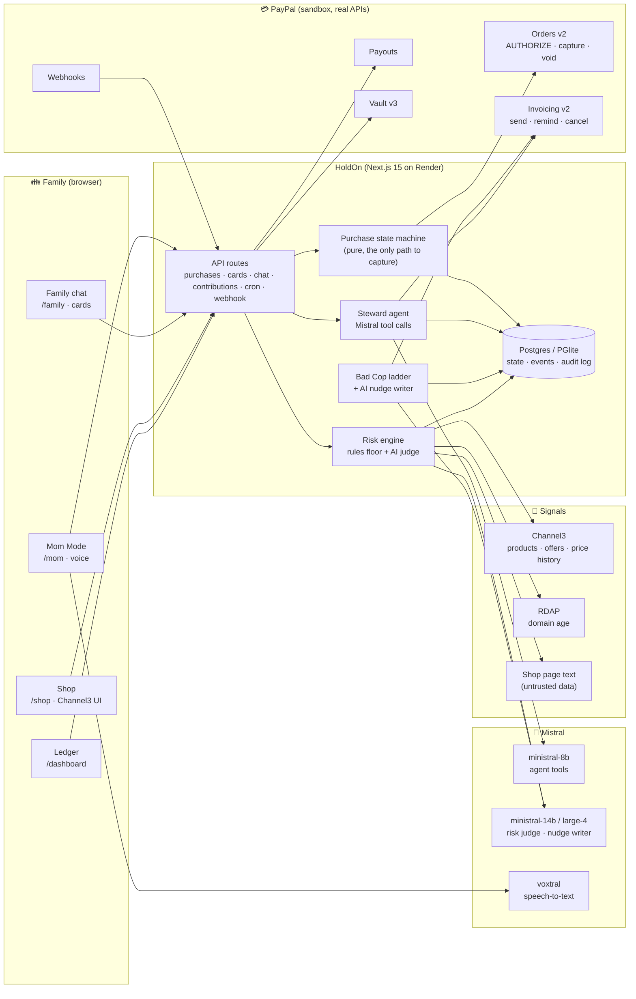
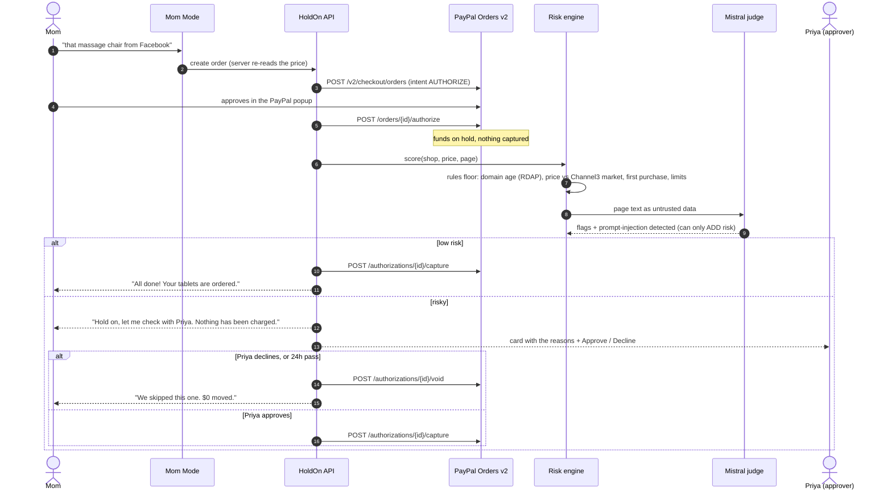
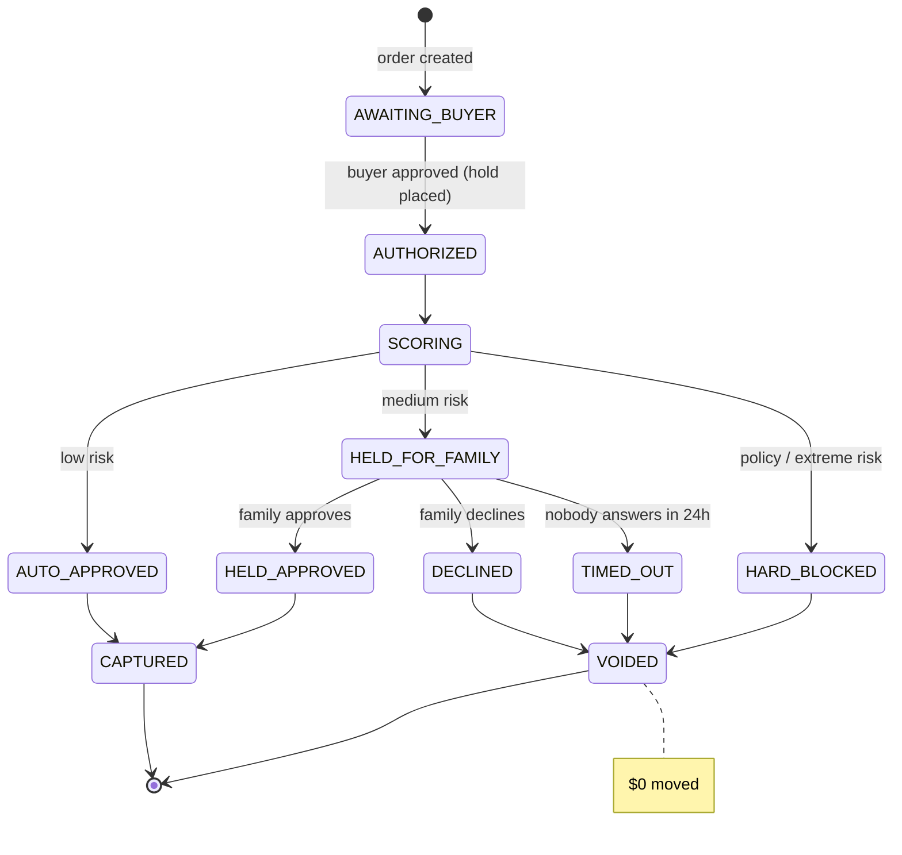
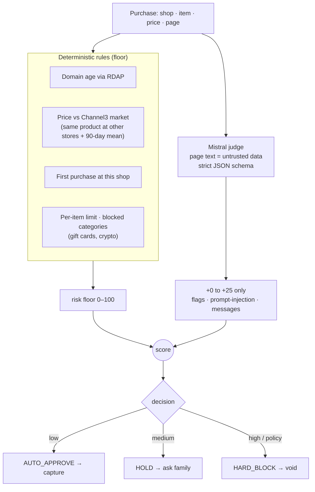
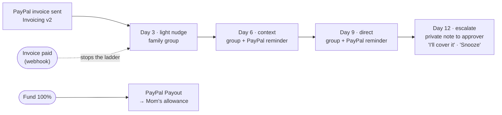
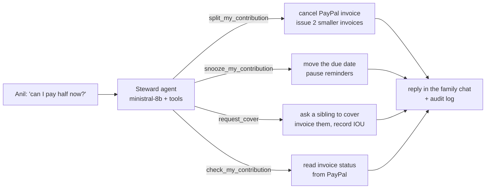

<div align="center">

# ✋ HoldOn

### The family wallet that knows when to say *"hold on."*

**An AI money steward for families who chip in for Mom: it collects everyone's share on PayPal, and it puts every risky purchase on a real PayPal authorization hold until the family says yes.**

[**Live demo**](https://holdon-7x87.onrender.com/demo) · [Devpost write-up](docs/DEVPOST.md) · [Risk scorecard](evals/SCORECARD.md) · [Architecture](#architecture)

`PayPal Orders v2 (AUTHORIZE / capture / void)` · `Invoicing v2` · `Payouts` · `Vault v3` · `Webhooks` · `Mistral (agent + judge + writer + Voxtral)` · `Channel3` · `Next.js 15`

| 10/10 scams stopped | 0/7 everyday buys wrongly held | 2/2 hidden AI-agent instructions caught | $0 moved on every "no" |
|:---:|:---:|:---:|:---:|

</div>

---

## The problem

Millions of adult siblings pool money every month for an aging parent. Two jobs nobody wants:

1. **Chasing the sibling who's late.** Every family has one. Every reminder costs a little goodwill.
2. **Stopping Mom from paying a scam shop.** Older adults lose billions a year to fake stores: a "95% off" massage chair from a Facebook ad, a 9-day-old domain, a countdown timer. And as AI shopping agents arrive, scam pages now hide text telling *the agent* to approve the purchase.

Banks and cards only react after the money is gone. **HoldOn acts before it moves.**

## What HoldOn does

| | Feature | How it works |
|---|---|---|
| 👮 | **Bad Cop** | Every sibling gets a real **PayPal invoice**. Late? A Mistral-written nudge in the family chat, then PayPal's own invoice reminder, then a firmer one, then a **private note to the family approver**. The steward agent understands "can I pay half now?", "next Friday" and "can Priya cover me?" and *acts*: it cancels and reissues invoices, snoozes, or asks someone to cover. |
| ✋ | **Guardian** | Mom pays with PayPal, but PayPal only **authorizes** (a hold). HoldOn checks the shop's age (RDAP), the real market price (Channel3), and the page itself, including **hidden prompt-injection aimed at AI agents** (Mistral reads it as untrusted data, flags it, never obeys it). Safe → **capture**. Risky → ask the family; **Decline = void, $0 moved**. Nobody answers → the hold voids itself. |
| 💸 | **Settled** | When the fund is full, a **PayPal Payout** sends Mom her allowance. Every PayPal call and AI decision lands in a family ledger. |
| 🛍️ | **Shop real stores** | Channel3 search (text or **photo**) over millions of products, product pages with every store's price and 90-day price history, a HoldOn pre-check before paying, and the same hold → check → capture. |
| 🤖 | **Agentic refills** | After Mom's first trusted pharmacy purchase, **PayPal Vault** saves her PayPal. HoldOn's agent reorders her medicine monthly with no popup, and gets *no special powers*: its order goes through the same risk pipeline. |
| 🎙️ | **Mom Mode** | One mic button, huge type, Voxtral speech-to-text, and spoken replies: "Hold on, let me check with Priya first. Nothing has been charged." |

**The safety principle:** the AI can raise risk, never lower it, and it can never move money. Only a pure, unit-tested state machine can capture.

---

## Architecture

### System overview



### Guardian: a purchase, end to end



### The purchase state machine (`lib/state/purchase.ts`)

Pure, no I/O, unit-tested. Capture is only reachable from `AUTO_APPROVED` or `HELD_APPROVED`; every transition is a conditional database update, so a double-tapped "Approve" can never capture twice.



### The risk engine: deterministic floor, AI can only add



If Mistral is unavailable, a transparent offline heuristic takes over and the decision is logged as such, so the guard never fails open.

### Bad Cop: the escalation ladder



An hourly cron (Render) or the demo panel's fast-forward runs the ladder. Each nudge is written by Mistral from context (who, how late, what the money is for) with a template fallback.

### The steward agent: chat that acts



The agent only gets tools scoped to the person speaking. Chat text is data, never instructions, so nobody can talk it into capturing a payment.

---

**Risk engine scorecard** ([evals/SCORECARD.md](evals/SCORECARD.md), `npm run eval`, 20 labelled purchases):

| Metric | Result |
|---|---|
| Decisions correct | **20/20** |
| Scams held or blocked | **10/10** |
| Everyday purchases wrongly held | **0/7** |
| Hidden AI-agent instructions caught | **2/2**, 0 false positives |

---

## The 60-second story

1. Priya and Raj have paid. Anil hasn't. HoldOn nudges him in the family chat, then through PayPal's invoice reminder, then privately asks Priya whether to cover.
2. Anil replies "can I pay half now?" The agent cancels his PayPal invoice and issues two smaller ones.
3. Anil pays. The fund hits 100% and a **PayPal Payout** sends Mom her allowance.
4. Mom says "my blood-pressure tablets". PayPal authorizes, HoldOn checks (trusted pharmacy, normal price), and it's **captured** instantly.
5. Mom says "that massage chair from Facebook". PayPal authorizes. HoldOn finds a 9-day-old shop, a price 5% of market, and hidden text telling AI agents to approve, so it **holds**. Priya taps Decline, and the **authorization is voided**: $0 moved.

---

## How PayPal is used (sandbox, real API calls)

| Need | PayPal API |
|---|---|
| Mom's guarded purchase | Orders v2 `intent: AUTHORIZE` → `POST /v2/checkout/orders/{id}/authorize` |
| Family approves | `POST /v2/payments/authorizations/{id}/capture` |
| Family declines / nobody answers in 24h / policy block | `POST /v2/payments/authorizations/{id}/void` |
| Monthly shares | Invoicing v2: create → `send` → AI-written `remind` → `cancel` (when split) |
| Sibling pays in-app | Orders v2 `intent: CAPTURE` (PayPal JS SDK buttons) + record the payment on the invoice |
| Mom's allowance | Payouts `POST /v1/payments/payouts` |
| Save Mom's PayPal for agent refills | Vault v3 via Orders (`attributes.vault.store_in_vault: ON_SUCCESS`), then buyer-not-present orders with `payment_source.paypal.vault_id` |
| Source of truth | Webhooks (signature-verified): invoice paid, authorization voided, capture completed, payouts |

Every write carries a stable `PayPal-Request-Id` (idempotent retries), every state change is a conditional update (a double-tapped "Approve" can never capture twice), and every PayPal call is written to the audit log shown on the dashboard.

## How AI is used (Mistral)

| Role | Model | What it does |
|---|---|---|
| Steward agent | `ministral-8b-latest` (tool calls) | Reads the family chat and acts: `split_my_contribution`, `snooze_my_contribution`, `request_cover`, `check_my_contribution`, fund and purchase status |
| Risk judge | `ministral-14b-latest` → `ministral-8b-latest` → `mistral-large-4` | Reads the shop page as **untrusted data**, lists red flags, detects prompt injection, writes a calm message for Mom and a factual one for the family (strict JSON schema) |
| Bad Cop writer | `ministral-14b-latest` | Writes each nudge from context: who, how late, which step of the ladder, what the money is for |
| Mom's voice | `voxtral-mini-latest` (transcription) | Tap-to-talk in Mom Mode (browser speech recognition as fallback); replies are read aloud |

**Safety design:** deterministic rules set the risk floor (domain age, price vs. market, first purchase, per-item limit, blocked categories). The AI can only **add** risk (0–25), never lower it. Only the payment state machine can capture, never the model. Text on shop pages or in chat is treated as data, never instructions.

## How Channel3 is used

| Need | Channel3 |
|---|---|
| The shop's search (text, photo, or both) with brand, store, category, price and colour filters | `products.search` through the official SDK, from server actions, so the key never reaches the browser |
| Product pages with variant selection | `products.retrieve` with `selected_options`, using Channel3 UI's `useVariantSelection` |
| "Similar products" | `products.findSimilar` |
| Price history and the "is this a normal price?" pre-check | `priceTracking.retrieveHistory` |
| Risk engine price baseline | The same exact product at the other stores selling it, plus its 90-day mean (search-based median when there's no exact match) |
| UI | Channel3 UI components (shadcn registry): `product-search`, `product-details`, `offers-list`, `price-history-chart` and more, restyled to HoldOn's palette |
| Revenue | Every store link is a Channel3 commission link (`rel="sponsored"`), attributed to the family with `x-user-id` |

At checkout, HoldOn re-reads the price from Channel3 on the server instead of trusting the browser. It never fetches the buy link itself: that would count as a click.

**Other tools:** RDAP (domain registration date, free), AG Grid and AG Charts (family ledger and outcome chart), Telegram (optional mirror of the family chat).

---

## Run it locally (about 5 minutes)

Requirements: Node 20+, a free PayPal Developer account.

```bash
git clone https://github.com/priteshvirat24/holdon.git && cd holdon
npm install
cp .env.example .env.local
```

1. In **developer.paypal.com → Apps & Credentials → Sandbox**, open (or create) an app and paste its Client ID and Secret into `.env.local` (or run `npm run keys` for a hidden prompt that also tests them).
2. Add a Mistral key (`MISTRAL_API_KEY`). Without one, a transparent offline heuristic is used and the chat agent is disabled.
3. Optional: add a Channel3 key (`CHANNEL3_API_KEY`, free at trychannel3.com) to turn on the Shop and real market prices.
4. In **Sandbox → Accounts**, copy a *Personal* sandbox account email into `PAYPAL_SANDBOX_MOM_EMAIL` (receives the allowance) and note its password: you'll use it to log in to the PayPal popup as Mom or a sibling.

```bash
npm run dev
```

Open **http://localhost:3000/demo**, click **Reset & seed**, then **Stage view**.

No database to install: locally HoldOn uses embedded Postgres (PGlite) in `.data/`. Set `DATABASE_URL` to use a real Postgres.

### Useful scripts

```bash
npm test
```
State machine, risk rules, nudge ladder and demo stores.

```bash
npm run smoke
```
Live sandbox: real invoice and real AUTHORIZE order, no UI.

```bash
npm run risk-check
```
Runs the risk engine on the four demo shops.

```bash
npm run eval
```
Runs the 20-case scorecard and writes `evals/results.json` and `evals/SCORECARD.md`.

```bash
npm run e2e
```
Runs the full Bad Cop scenario against the running app: every agent tool, all four ladder steps, cover and the allowance payout (25 checks).

```bash
npm run telegram
```
Runs the Telegram bot locally with long polling (set `TELEGRAM_BOT_TOKEN`; in the group send `/link`, then `/iam Priya`).

### Payouts and the sandbox account's country

PayPal only lets some countries send Payouts. If the allowance step says *"You live in a country that is not allowed to send this payout"*, create a **US business** sandbox account (Sandbox → Accounts → Create), link a new REST app to it, and use that app's keys. Everything else works with any sandbox account; the app reports a refused payout in the chat instead of failing.

### Webhooks (optional locally, needed on Render)

PayPal needs a public https URL. After deploying (or with a tunnel), call:

```bash
curl -X POST "https://YOUR-APP/api/paypal/setup-webhook?secret=$CRON_SECRET"
```

Put the returned id in `PAYPAL_WEBHOOK_ID`. On a deployment (where `CRON_SECRET` is set) the call needs that secret and only registers `APP_URL`; locally, pass `-d '{"publicUrl":"https://your-tunnel"}'` instead. Without webhooks the app still works: API responses update state directly, and the agent's `check_my_contribution` tool reads invoice status from PayPal.

## Deploy on Render

`render.yaml` defines the web service, a Postgres database and an hourly cron job that runs the Bad Cop ladder and expires undecided holds. Render → New → Blueprint → this repo, then fill in the PayPal, Mistral and Channel3 keys and `APP_URL`. The web service and database are on Render's free plan; the cron job is paid and optional (the demo panel's "Run scheduled jobs now" does the same). After the first deploy, register the PayPal webhook (above) and set `PAYPAL_WEBHOOK_ID`.

---

## Screens

| Path | What |
|---|---|
| `/stage` | Mom's tablet and Priya's phone side by side (made for the demo video) |
| `/mom` | Mom Mode: one mic button, huge type, PayPal button, warm spoken status |
| `/family` | The family group chat with approval cards and "pay my share"; switch who you are |
| `/dashboard` | AG Grid ledger, KPIs, and an "under the hood" feed of every PayPal and AI call |
| `/demo` | Reset, fast-forward the family clock (to show the nudge ladder and hold timeouts), run jobs, trigger the agent's monthly refill |
| `/pay/[id]` | A sibling pays their share with PayPal (recorded on the PayPal invoice) |
| `/shop` | Real products from Channel3 (text or photo search, filters, product pages, similar items), bought through HoldOn's hold → check → capture |
| `/stores/*` | Fictional demo shops (`.demo` domains), including the scam store with hidden AI instructions |

## Project layout

```
lib/paypal/        PayPal client (token cache, idempotency, audit log) + Orders/Payments/Invoicing/Payouts/Webhooks
lib/state/         Purchase state machine (pure, unit-tested)
lib/flows/         purchases (Guardian), contributions (Bad Cop), card actions
lib/risk/          rules (floor), signals (RDAP, Channel3, page text), judge (Mistral), assess
lib/channel3.ts    Channel3 SDK on the server: fresh offers at checkout, exact-product price baseline, pre-check
app/shop/          the Channel3 shop (server actions + Channel3 UI components)
components/        Channel3 UI and shadcn components
lib/badcop/        nudge ladder + AI nudge writer
lib/agent/         steward agent (Mistral tool calls)
lib/mistral/       client: model fallbacks, rate-limit handling, JSON schema
app/api/           routes: purchases, cards, chat, contributions, PayPal webhook, cron, demo
```

## Honest limitations and the production path

- **Demo stores settle to the HoldOn sandbox business account,** so HoldOn can capture or void. In production this runs on PayPal's multiparty platform with HoldOn as a partner, or as a checkout guard (browser extension) on any store.
- **Sandbox account country matters.** With a non-US sandbox business account, PayPal refuses Payouts ("not allowed to send this payout") and card processing. Mom's PayPal-account purchases still work. Use a US business sandbox account to see everything.
- **The `.demo` shop registration dates are seeded.** Real domains are checked live via RDAP.
- **Money never sits with HoldOn:** it moves only on PayPal's rails, and HoldOn orchestrates.

## License

MIT
